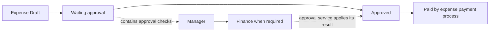
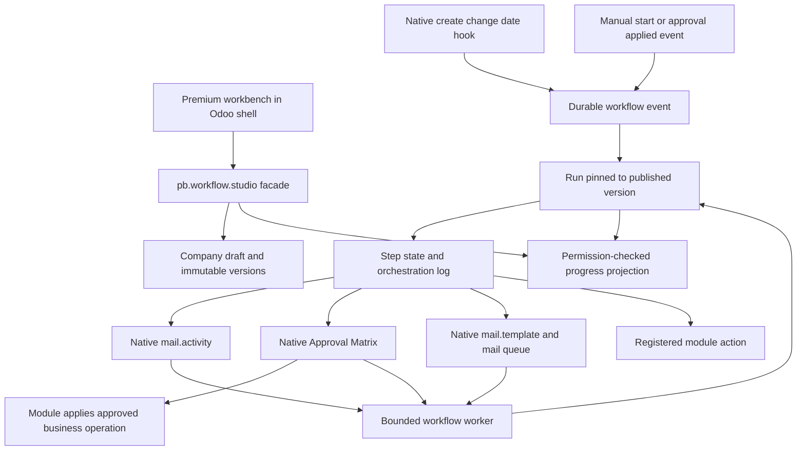

# Workflow Studio design and implementation

Payobook Workflow Studio is a graphical process editor and execution coordinator for business users on Odoo 19 Community. It combines forms, tasks, decisions, parallel paths, waits, approvals, emails and supported module actions. The aim is a readable, premium application experience across business modules, with existing approval, access, messaging and module services retaining their authority.

This document describes implementation commit `f68945ecc39b2845f00f09a77e3fa2941ffe640c`, module version `19.0.1.9.0`, as reviewed on 10 November 2026. [The artifact map](ARTIFACT_MAP.md) links the underlying files. [Decisions and gaps](DECISIONS_AND_GAPS.md) identifies prototype-only features and areas where the implementation should be challenged.

## 1 The product problem and user requirements

The user wanted a system-wide workflow configurator that felt intuitive rather than technical: readable fonts, clear hierarchy, quiet borders, understandable words, graphical editing, progressive disclosure and useful motion. The POC needed to represent the eventual product rather than merely illustrate an idea.

The requirements developed to include:

- At least three design options, informed by more than Darwinbox, Zoho and n8n.
- Dragging a block to a different position must change execution order, update connections and support Undo. Free placement alone is insufficient.
- Add steps, people, rules, conditions, emails, parallel work, waits, stages and information-collection forms.
- Collect multiple typed fields in one task, with a clear participant experience.
- Reuse Approval Matrix, People & backups, Access Studio, module settings, existing tasks and templates; avoid duplicate configuration or duplicate side effects.
- Work across installed business modules and allow an entirely new process without first building an Odoo model.
- Reuse appropriate Odoo 19 Community automation capabilities behind premium controls.
- Preserve existing functionality, approval rules and running work.
- Open a record's actual workflow position as a visual flowchart, subject to permission.
- Distinguish the record's real stages from the editor's grouping of workflow steps.
- Let workflow designers find, edit or create workflows from a record, for either the module or that record alone.
- Offer a compact horizontal journey that wraps and reverses direction at each row.
- Use a premium email composer and return to the exact originating workflow, selected step and view.

These are product requirements, not a statement that every possible native module action or every prototype control is implemented.

## 2 The recommended interaction model

The initial three alternatives became three views of one definition:

| View | Intended job | Current implementation |
| --- | --- | --- |
| Journey | Everyday step-by-step process design | Default vertical view, grouped into sections. |
| Flowchart | Understand paths, branching and joins | Connected graph with zoom, fit, semantic insertion targets, dragging and a Move alternative. |
| People | Inspect responsibility and handoffs | Groups human tasks/forms by assigned owner; approvals remain owned by Matrix. |
| Across | Compact overview for wider processes | Added later: rows run left-to-right, then right-to-left, with turns and separate parallel lanes. |

The same saved definition drives these views. Across is currently a **builder view**; runtime progress uses Flowchart. Deep nested groups in Across link to Flowchart instead of flattening concurrent work into a misleading sequence.

The main tabs are **Build**, **Try it out**, **Review**, **Activity**. The library, **My tasks**, and activity listing provide separate entry points for designers and participants. A designer selects a card to open a contextual inspector. Common actions appear first; advanced types are under **More possibilities**. No separate native Odoo technical form is intended for routine workflow configuration.

The POC's visual direction uses Inter, readable card titles and form text, restrained purple emphasis, white cards on a pale neutral surface, meaningful status colors with text labels, and reduced-motion support. The implementation has its own CSS and icon helpers in the standalone workbench; it is hosted in the existing Odoo shell through an OWL iframe wrapper. It does not fully share every application design-system component. Consolidation is an explicit review question.

## 3 User journeys

### Design a workflow for an existing module

Open Studio, create a named workflow, and select an accessible business record type. Alternatively, open a saved record and choose **Set up workflow**. The record setup page lists workflows already associated with that model and company before offering a new draft. It does not assert that every listed workflow currently matches this particular record; users must inspect the filters.

Choose between **Matching records in this module** and **Only this record**. The latter uses an ordinary record-ID equality filter in the definition's scope. It is enforced by both native automation domains and runtime evaluation. It is not a separate per-record override engine, and it does not suppress other matching workflows.

New workflows start as inactive drafts with a manual trigger. Creating or editing one does not publish, activate, submit an approval, send mail or move the source record. The user configures the start, scope, sections, steps and integrations, tries sample values, resolves review issues, and asks a publisher to publish and explicitly activate it.

### Design an entirely new process

Choose **A new process (no existing record)**. The process uses workflow-run records, forms and answers rather than creating a new business model. It can collect information, assign work and use a native Approval Matrix process entry. Publication creates the approval-catalogue integration for a standalone process; approval rules remain configured in Matrix.

This is suitable for additional requests and orchestration. It does not automatically create a new business module, arbitrary model fields, accounting entries or a fully configurable database schema. A new installed business module becomes selectable if it meets the model and access rules; business-specific transitions still need adapters.

### Complete a human task

A Collect information block can contain many questions. Its builder is inside the step inspector; preview is a modal, while the participant completes a dedicated full-screen task through **My tasks**. There is save/resume, inline validation and a deliberate submit action. Assign a task uses the same native activity infrastructure without a form schema.

The run owns the task's orchestration identity, while `mail.activity` supplies the assigned activity and due date. The activity is linked to `pb.workflow.run`, not automatically to a duplicate task in every source module. The standard activity-completion path is guarded so it cannot bypass required form validation. Existing employee-journey token pages remain separate; the new Studio task facade requires an internal signed-in user.

### Inspect a record's progress

A supported native record form exposes **View workflow** when the user can see a linked run/approval or native stage context. Multiple permitted runs or approval attempts produce a chooser. A record with stages but no run shows its current stage and an honest no-workflow-started message.

For a Studio run, the graph comes from that run's immutable version. Current human leaves, including parallel leaves, can be highlighted together. Completed, waiting, failed, skipped and upcoming work have distinct text/status cues. Selecting a step shows permitted owner, due time, waiting/failure reason and relevant approval details. A progress permission does not automatically expose form answers, email configuration or execution identities.

Native approval records that predate Studio can also appear through the approval-progress adapter. That chart represents the actual approval attempt; it is not an invented end-to-end Studio run. A current native-stage strip sits above it. Progress refreshes on a 15-second UI interval; execution workers run separately, so this is not a push stream or a sub-second timing guarantee.

### Create or edit an email template

The Send an email block selects an existing `mail.template` or opens a premium full-screen composer. It supports name, subject, body formatting, record details, From/To/Cc/Reply-to, language expression, advanced HTML and a rendered sample. Preview uses the native template renderer with a permission-checked sample and does not queue mail.

Save edits the same shared template or creates one for the correct model. Editing warns that other uses of that template change too. Native settings outside the editor, such as existing attachments, are preserved. A `write_date` concurrency check prevents overwriting a newer edit. Template-editor permissions remain separate from workflow design.

Body placeholders preserve QWeb markup through native outgoing-email sanitization. Preview is sanitized after rendering and displayed in a restricted iframe. The wrapper and shared `openHub` return protocol carry workflow ID, selected node, view and tab so that save, cancel or return from existing settings goes back to the right place.

## 4 Record stages and workflow sections

This distinction addresses the central confusion in the user's screenshots.

| Concept | Example | Owner and behavior |
| --- | --- | --- |
| Native record stage/status | Expense: Draft → Waiting approval → Approved → Paid | Existing module field and business actions. The strip reflects the record's current value. |
| Approval route | Manager check, then Finance check | Approval Matrix. These checks occur within the relevant native approval status. |
| Workflow section | Prepare, Do the work, Finish | A grouping of workflow nodes in a versioned definition. Completing it does not write a native status. |
| Workflow step state | Pending, waiting, done, failed, skipped | Orchestration runtime. Distinct from the source record's status. |

This is an explanatory example, not a universal transition graph. Refusal, return, cancellation and other exceptions remain controlled by the module. Stage ordering alone is never evidence that an earlier stage was visited or completed.

The current **Stages** button opens existing record stages. **Sections** edits workflow groupings. The old JSON keys `stages`, node `stage`, `workflow.stage` and `workflow.completed_stages` remain for compatibility; their current UI meaning is sections. In filter evaluation, `workflow.stage` is the evaluated node's section index. Completed sections are nonempty sections whose steps are all done or skipped. This is not a global source-record state machine or proof that all the section's work was performed.

Native stage discovery reads accessible statusbar fields from the model's form, falling back to `stage_id`/`state`. Unambiguous native visibility is reused. Conditional variants are not evaluated as an entire live form; all choices are shown rather than guessing. Relational choices respect normal read permissions and company scope where present; a specific Hiring record also scopes choices by job. This convention-based discovery is a useful starting point, not a complete semantic adapter for every model.

A **Wait for this** shortcut creates a normal wait condition on the real field/value. The same field is available in filters. Moving a record requires a supported module action; renaming a section never moves a record.

Hiring stage renaming is implemented through the existing `pb.hiring.act('stage_rename')` service, with Hiring configuration permission, a row lock and revision check. It changes the same shared stage everywhere. Arbitrary new Hiring stages are not implemented: `pb_key` is a controlled selection, with families, presets, events and guards. Fixed Expense/Pay/Time statuses are also not freely editable. New native stages require a module-owned operation that defines their behavior. Other stage settings remain reachable in their owning module.

An older approval attempt may be viewed beside the record's **current** status. The UI explains when the record has moved beyond that approval status. It does not reconstruct a historical native-status timeline.

## 5 Block catalogue and form capabilities

| Block | Shipped behavior | Boundary |
| --- | --- | --- |
| Start | Manual, record created, selected fields changed, relative record date, after approval application | Automatic starts require a source model and relevant process/date configuration. |
| Collect information | Versioned multi-field form, owner, due date, save/resume, validation | Answers do not automatically create or update arbitrary source fields. |
| Assign a task | Initiator, employee manager, named user, single-person responsibility, or source user field; compatible native activity type | Assignment never grants record access; approval-only cover remains with Matrix. |
| Use Approval Matrix | Submit or adopt an eligible existing approval request; wait for native application/outcome | No second approver-chain editor; required approval cannot be conditionally bypassed. |
| Send an email | Shared native template, native queue, delivery status and reuse of the same mail on retry | Additional purpose required; existing module notifications remain separate. |
| Choose a path | Ordered named routes, typed conditions, fallback, nested steps | Structured tree, not arbitrary looping BPMN. |
| Work in parallel | Independent eligible paths; all-finish or first-finish join | First-finish groups restrict irreversible automatic effects; not a distributed parallel job framework. |
| Wait | Elapsed hours or a live condition with a maximum wait | Checked by a periodic worker; timeout requires attention. |
| Add a saved group | Insert copied steps from a published compatible group, with source-version label | Independent snapshot copy; not a live shared dependency with upgrade propagation. |
| Use a module action | A registered, guarded business operation; Hiring stage move is the concrete built-in integration | Generic arbitrary method/field writes are not accepted. |
| Show existing work | Reference to an existing owner/settings area | Explanatory only; it neither executes nor monitors that external work. |

Forms support short text, long text, number, date, email, dropdown, multiple choice, Yes/No, file, repeatable description/amount rows, section headings and record lookup. Fields can be required, have help/minimum values, and depend on earlier answers for visibility. Read-only prefills can use permitted source fields. Standalone forms can bind selected number/boolean answers into the amount/urgent approval facts.

Server validation checks types, required visible answers, allowed lookup records and attachment ownership. Uploads use private `ir.attachment` records tied to the workflow step, with a 10 MB per-file limit. Repeatable rows are a bounded built-in structure, not a general spreadsheet designer. Form schemas live in the published workflow graph. The production UI does not expose the POC's full separately governed reusable form-template library.

Current structural limits include 200 nodes, 1–40 sections, up to 80 form fields, 2–10 paths per group, 12 nested groups, and four levels/20 rules per condition group. These are validation bounds, not measured performance guarantees.

## 6 Filters and routing semantics

The premium filter builder uses typed field/operator/value controls and nested **All** / **Any** groups. It appears on start scope, before-change conditions, optional steps, branch/parallel paths and waits. It does not show raw Odoo domain syntax to business users.

Values can include permitted stored source fields, existing record stages, earlier guaranteed form outputs, the initiating person, the initiator's current access-group memberships, the evaluated workflow section and completed sections. “Started by · access role” means the initiating user's group membership; it is not the current assignee's role, an approval responsibility seat, or an access grant.

Before/after source filters compile to validated native Odoo domains. Runtime filters use the pure `matches()` interpreter. A null-value guard was added so negative comparisons agree with native domains for supported nullable types. Domain/interpreter/preview parity deserves continued testing, especially around dates, empty values, related records and translations.

New step filters and grouped branch rules read current source values when reached. Legacy single-leaf branch rules retain the initial snapshot behavior. Parallel eligibility is evaluated once and recorded: excluded paths are skipped and cannot accidentally win a first-finished join. Only eligible paths participate in the join; if none qualify, the group continues. A wait condition is rechecked while waiting. Starting a step does not continuously reevaluate whether it should have started.

The record-only option is a normal `id = selected record` scope. It cannot bypass company checks. Multiple workflows can still match the same record, so the option is not an exclusive binding or override.

## 7 Service ownership and overlap prevention

| Concern | Existing owner reused | Studio's responsibility |
| --- | --- | --- |
| Approval routing, people, cover, safeguards, application | `biz.approval.engine`, Approval Matrix | Reference and coordinate the native request; show its progress. |
| Access and access delegation | `biz_access`, Odoo ACLs/record rules/company context | Recheck rights; expose separate progress/design/publish abilities. |
| Ordinary tasks and due dates | `mail.activity`, company working calendar | Link each orchestration step to its activity and validate completion. |
| Ordinary emails | `mail.template`, native mail renderer/queue | Premium editor, template reference, queue/result tracking. |
| Hiring candidate messages | Hiring's company/key templates, renderer, sender and ledger | Keep ownership in Hiring; do not route them through a duplicate generic sender. |
| Native business stage changes | Module-specific facades/actions | Invoke registered operations under the execution user's rights. |
| Record create/change/date hooks | Stock Community `base_automation` | Generate an owned rule that captures a durable event. |
| Attachments | `ir.attachment` | Bind uploads to the right task and enforce access. |
| Credentials/external arrivals | Existing Integrations services | Keep them outside the generic builder until an explicit adapter is supplied. |
| Existing employee journeys and reminders | Existing lifecycle templates/cases/tasks/generators | Leave them running; do not auto-migrate them into Studio. |
| Settings navigation | Existing application hubs and return protocol | Provide contextual entry and restore the original editor context. |

The implementation rejects repeated sends using the same template within a graph, requires a reason for additional email, surfaces active native automation and other Studio workflows, owns generated automation explicitly, and enforces required Matrix placement. Existing pending/blocked/approved native requests can be adopted rather than creating a second active route.

This is **not complete semantic duplicate detection**. Different templates can send equivalent messages. Bespoke module hooks, delayed jobs and human processes may overlap with a Studio action without being recognized. The reviewer should assess whether stronger event/effect ownership and conflict explanation are needed before broad adoption.

There is also a real architectural distinction: Studio adds `pb.workflow.run` and `pb.workflow.step` rather than extending `pb.journey.case` and `pb.journey.task` directly. It reuses activities, approvals and mail, but it is an additional orchestration state model. The earlier POC recommendation to extend existing journeys first was not implemented literally. Whether this is appropriate separation or avoidable duplication is a central review question.

## 8 Odoo Community automation and execution architecture

The installed stock `base_automation` service handles record hooks and date triggers. Enterprise Studio is not a dependency. The native automation's generated server action contains application-owned capture code; end users are not given an arbitrary Python editor.

Automatic capture does not execute the whole process within the triggering record transaction. Events have durable identities/deduplication keys. A worker processes pending events and advances active runs under the configured execution user and current permissions. Manual starts also enter through the event path.

Runs are locked while advancing. Steps have persistent identities and links to their activity, request or queued mail. Automatic leaf work runs inside a savepoint; failures become visible state. Completed work is not deliberately replayed on a step retry. This provides useful transactional coordination; it does not prove exactly-once delivery at an external provider.

The cron is configured for one-minute intervals, with bounded batches (100 pending events and up to 300 active runs per pass; approval-applied scanning is bounded per workflow). Parallel human tasks can remain active together, while traversal itself executes in the worker's ordered code. There is no claim of unlimited concurrency, distributed worker scheduling, event-driven wakeups or load-tested enterprise throughput.

The main additional models are:

| Model | Purpose |
| --- | --- |
| `pb.workflow` | Company definition, draft revision, publication pointer, enabled flag, execution user, generated native automation and reusable-group flag. |
| `pb.workflow.version` | Immutable graph/form snapshot, execution user, permitted starters and publication metadata. |
| `pb.workflow.event` | Captured start, source record, pinned version, initiator, key, state, error and resulting run. |
| `pb.workflow.run` | Durable process instance, source record, version, actors, facts, state and timing. |
| `pb.workflow.step` | Node instance/configuration, state, assignment, answers, chosen paths, wait time, attempts and native-service references. |
| `pb.workflow.log` | Append-oriented orchestration events, actor and step key. |

The definition schema is `payobook.workflow/1`. A root order contains node IDs; branches and saved groups contain child ID lists. Each node belongs to exactly one path/container. Group/section order and supported structure are validated. This is a structured graph/tree editor, not an unrestricted cyclic graph with manually connectable arbitrary edges.

## 9 Approval and module integration

Approval-capable source models must select their existing approval process and retain the required Matrix reference. An after-approval-applied workflow must not request approval again. The module/approval service applies business effects; Studio must not also write Approved/Paid/Joined to simulate the same result.

Standalone custom workflows expose their own request facts through the existing approval catalogue. Submission answers are frozen for approval. Progress viewing and full submission access are separate. Returned simple custom submissions can reopen information and create a fresh approval attempt; complex paths with intervening side effects require a corrected new request rather than replaying completed actions.

Module extensions can provide `_workflow_capabilities()` and `_workflow_execute()`. The current built-in special case for `hr.applicant` calls the Hiring facade for a permitted stage move; protected outcomes remain native. The generic mechanism supports future adapters, but its existence does not mean every business action has been implemented for every selectable model.

Native stage editing currently has a specific guarded Hiring rename path rather than a universal stage-management contract. The proposed general contract would declare catalogue, scope, allowed edits/creation, permitted transitions and side effects, while using the module's existing implementation. That generalization is a recommendation, not shipped functionality.

## 10 Permissions and change management

- **View progress** permits a sanitized progress projection for accessible records. It does not grant design, publication or unrestricted submitted-answer access.
- **Designer** creates and edits workflows, previews, and accesses run-management operations subject to the facade's checks.
- **Publisher** additionally publishes and activates, and controls execution identity and starter grants. Administrator behavior is defined in the facade rather than inferred from UI visibility.
- **Participant** completes only assigned tasks and permitted source information. The configured execution user does not make every assigned person a superuser.
- **Module configuration authority** remains necessary to rename shared Hiring stages or edit shared email templates. A workflow Designer alone does not gain those rights.

The model picker admits installed, persistent, readable business models with `company_id`, excluding technical/transient categories. Source records must exist, be readable and belong to the current company. “All modules” therefore means this supported business-model scope, not every technical Odoo object, every company-less/shared record, or every bespoke screen.

Draft saves use optimistic revisions. Published versions are immutable; running work stays on its version. Publication and activation are separate. Pausing stops new starts; holding a run pauses its own advancement. Cancellation requires pending native approval withdrawal first and does not undo already-sent emails or applied business actions. Designer Undo only changes the draft definition.

Version pinning is not a complete historical snapshot of everything the run uses. Shared templates, native settings, current source values for newer filters and current access permissions remain live. Template/stage concurrency checks prevent lost edits but do not pin their old content for every run. A reviewer should assess whether stronger version-aware shared-resource policies are warranted.

## 11 Premium UI implementation and maintainability

The workbench's actual source is `pb_lifecycle/static/workflow/`, hosted by `static/src/js/workflow_studio.js`. The wrapper uses authenticated same-origin RPC and checks the origin/source of navigation messages. Form hooks add record progress/setup controls; separate menu and palette entries provide Studio access.

`graph.js` shares graph layout and card rendering between the builder and progress view. `forms.js`, `conditions.js`, `templates.js` and `record-context.js` supply the corresponding inspectors and pages. CSS includes responsive drawers, mobile navigation fixes, graph/card styles and reduced-motion support. UI updates mostly rebuild HTML from JavaScript state rather than using a full shared OWL component hierarchy. Review focus/scroll preservation, localization, accessibility and long-term component reuse explicitly.

The runtime viewer reuses graph rendering but disables definition editing. It shows record-stage context and actual approval information without inventing a native stage history. Flowchart move targets change order, group membership and section membership; invalid moves are rejected and keyboard/touch users can use Move. Published runs are unaffected by rearranging a draft.

Known UI evolution includes larger fonts and clearer hierarchy, multi-field participant screens, replacing native template forms with the premium composer, exact return navigation, fixing Review text alignment, adding Across, separating Stages from Sections, adding record-level setup, and fixing narrow-screen navigation overflow. The POC is the earlier visual reference; it should not be used as an exact pixel specification for features added later.

## 12 Current verification and operational scope

The recorded release was verified on `payobook`, `payobook_template`, `p0clone` and production `rize`, with 159 combined custom module trees and installed versions checked. The deployed backend suite passed 42 tests. The latest Chrome run verified native expense progress and stage context, one-record drafts, real stage-based waits, section editing, Designer/Publisher separation, premium shared-stage rename entry/cancel, setup from a second module with no run, and mobile fit. Earlier releases separately exercised forms, templates, drag/Undo, parallel filtering and return navigation.

These results do not establish exhaustive end-to-end correctness for all modules, formal accessibility compliance, complete localization, large-scale performance or all concurrency/failure modes. The five-module checks across four databases were setup/metadata checks, not full payroll/leave/hiring business-cycle tests.

Temporary test users, draft workflows, contacts and screenshots were removed. No workflow was automatically activated by the release. Existing activation/version choices and cron settings were preserved. ABM remains retired. [VERIFICATION.md](VERIFICATION.md) links the recorded evidence and distinguishes implementation checks from this documentation pass.

## 13 Recommended direction and review decision

Keep one clear business-user workspace and reuse the native services that own approvals, access, stages, mail and module effects. Expand capabilities through business-specific adapters, not a generic raw write/action console. Preserve a readable Journey default and show complexity only where the process needs it.

The independent reviewer should decide whether to retain the added orchestration models, consolidate selected components with existing Lifecycle/Hiring/filter services, or make a larger architectural change. They should also evaluate whether the Stages/Sections split is understandable enough, whether record-scoped workflows create governance problems, and which prototype concepts are worth implementing next. The existing recommendation is open to challenge; a successful review should identify tradeoffs and implementation changes, not merely endorse the current UI.
